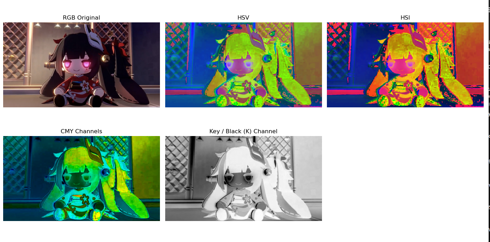

# Tugas model warna 

Konversi warna dari RGB ke CMYK, HSI, HSV

---

## Hasil

Hasil implementasi kode pada gambar contoh

### 1. Perbandingan Ruang Warna
*(Ganti tautan gambar di bawah dengan screenshot hasil program Anda)*

### 2 Penjelasan Hasil:
* **RGB Original:** Citra masukan standar.
* **HSV:** Pemisahan warna berdasarkan Hue, Saturation, dan Value.
* **HSI:** Ekstraksi intensitas pencahayaan terpisah dari informasi warna.
* **CMYK:** Dekomposisi kanal warna cetak (Cyan, Magenta, Yellow, Key/Black).

