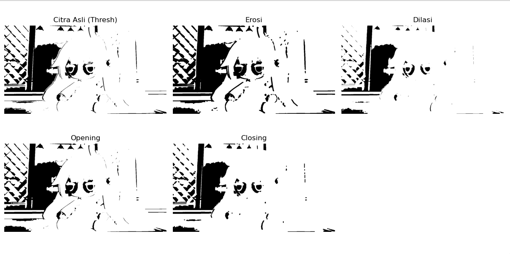

# Morfologi

Proyek Python sederhana menggunakan OpenCV dan Matplotlib untuk mengimplementasikan dan memvisualisasikan 4 operasi dasar morfologi pada citra biner: erosi, dilasi, opening dan closing

---

## Filter
* **Pre-processing Citra**: Konversi otomatis ke grayscale dan binarisasi (thresholding).
* **Pemprosesan Morfologi**:
  * Erosi : Mengikis batas objek.
  * Dilasi : Menebalkan/memperbesar area objek.
  * Opening : Menghilangkan noise bintik putih luar.
  * Closing : Menutup celah/lubang hitam di dalam objek.

## Visualisasi hasil

